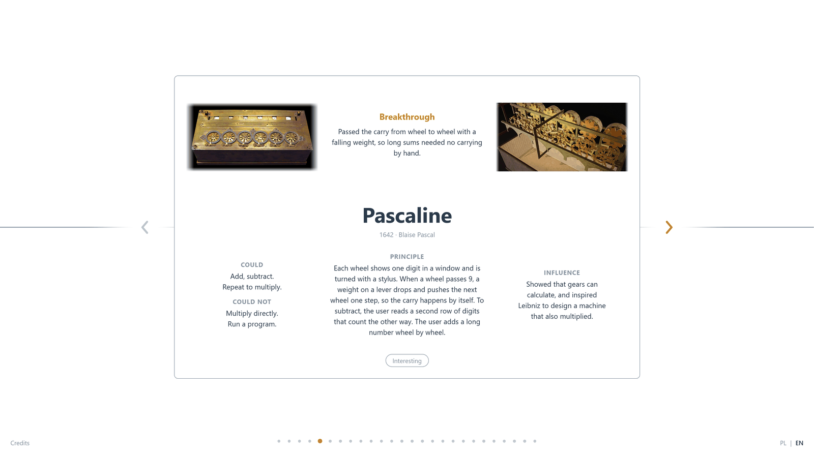
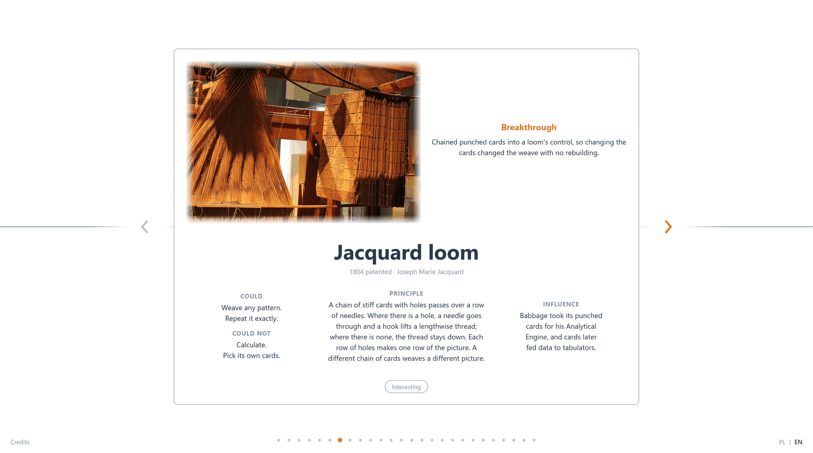
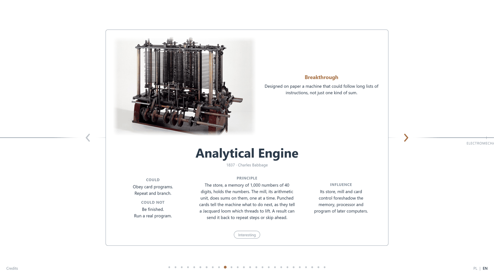
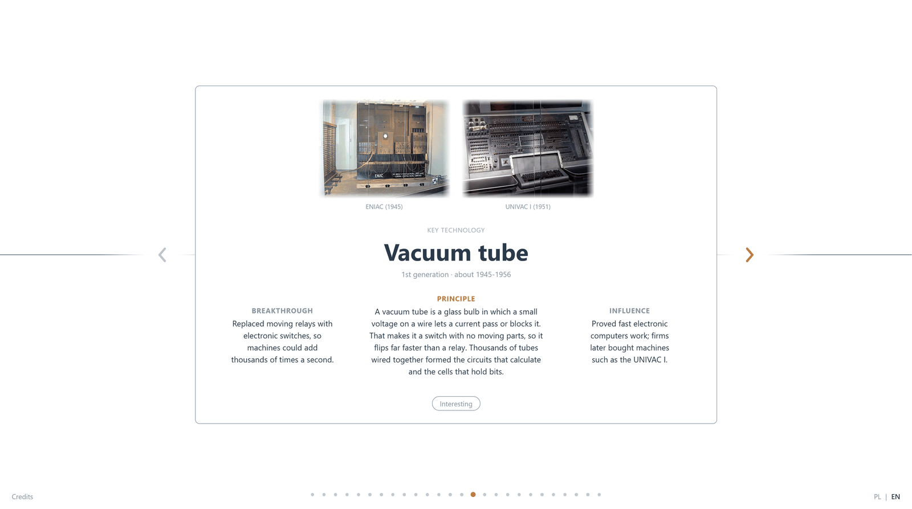
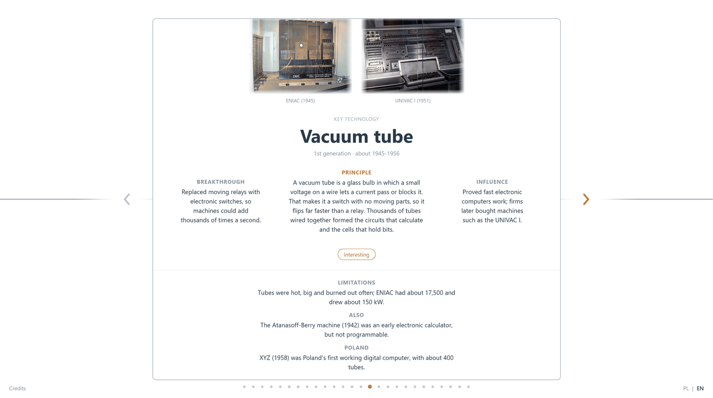

**One timeline from the abacus to multicore: how computers developed, how they are built and how they work**

[**evolution-of-computers.vercel.app**](https://evolution-of-computers.vercel.app/)

---

A small static website. Each card is one step in the history of computing, from mechanical calculators to computer generations and architecture ideas, with a photo, a plain-words explanation of the principle and a short "Interesting" panel.

- 26 cards on one continuous timeline, with navigation dots
- English and Polish
- Photos from Wikimedia Commons, credited in the Credits panel

## A few examples

| Pascaline | Jacquard loom |
|:---:|:---:|
|  |  |

| Analytical Engine | Vacuum tube |
|:---:|:---:|
|  |  |

| "Interesting" panel | Closing card |
|:---:|:---:|
|  |  |

## Run

No build step: open `index.html` in a browser.

## License

Code: [MIT](LICENSE). Images come from Wikimedia Commons and keep their own licences, see [CREDITS.md](CREDITS.md).

